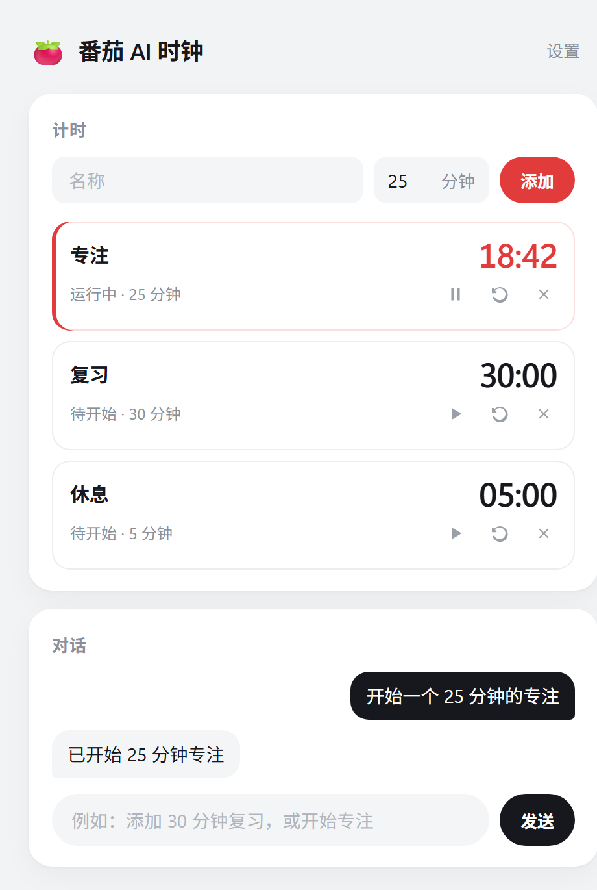

# 番茄 AI 时钟

通过对话管理番茄钟。用自然语言告诉 AI 增删改、开始/暂停/重置计时器。



## 运行

```bash
npm install
npm start
```

打开 http://localhost:3000

## 桌面小工具 (Tauri)

打包成独立桌面应用：原生窗口 + 系统托盘图标，启动时自动拉起 Node 服务，关闭窗口最小化到托盘（不退出），点托盘图标显示/隐藏窗口，托盘菜单「退出」才真正退出。最小化后窗口收成一行倒计时，拖动可移动，双击展开。


```bash
# 开发模式 (需已安装 Rust 工具链)
npm run tauri:dev

# 构建发布版, 产物在 src-tauri/target/release/
npm run tauri:build
```

发布版是一个自包含的 `pomodoro-ai.exe`：网页和计时服务打在文件里，双击即可运行，不需要另外安装 Node。配置和计时记录写在 `%LOCALAPPDATA%\pomodoro-ai`。本机仍需安装 Ollama（模型不打进 exe），以及系统自带的 WebView2。

> 环境要求：Rust (cargo) + MSVC C++ 构建工具 + WebView2（Win10/11 自带 Edge 即包含）。

## 对话示例

- "添加一个 30 分钟的复习时钟"
- "开始专注"
- "把专注改成 50 分钟"
- "暂停复习"
- "删除复习"

## 本地模型

对话走本机 [Ollama](https://ollama.com)，不使用云端网关。

要求：

- 已安装 Ollama，并且服务在运行。默认地址 `http://127.0.0.1:11434`。
- 至少拉取一个**对话模型**。嵌入模型（如 `nomic-embed-text`、`bge-m3`）不能用来聊天。当前配置使用 `qwen3.5:4b`：

```bash
ollama pull qwen3.5:4b
```

- 在页面右上角「设置」里填写 Ollama 地址，并从本机已安装的模型列表中选择一个，保存后立即生效。也可以直接改 `config.json` 的 `ollamaUrl` 和 `model`。
- 未选择模型就发送对话时，会提示先去设置里选择。

## 目录

```
server.js        后端: 计时器 + SSE + Ollama 对话
config.json      ollamaUrl、model、休息提醒间隔
timers.json      计时器持久化 (自动创建)
public/          前端页面
```
